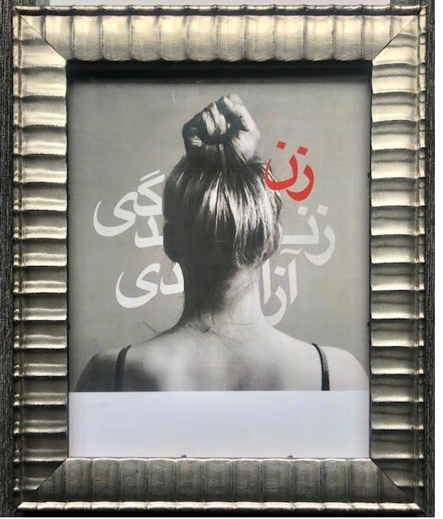
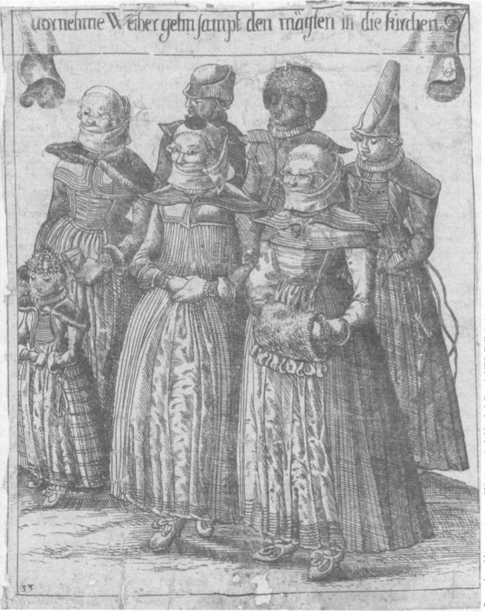
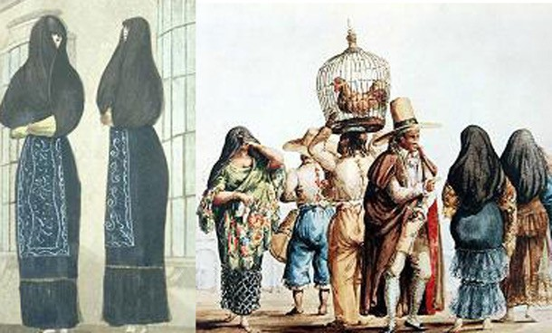
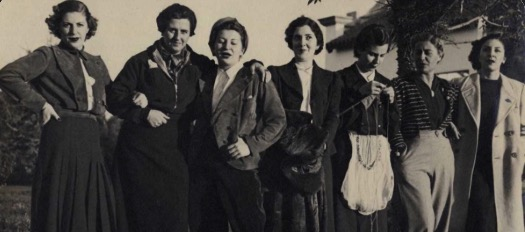
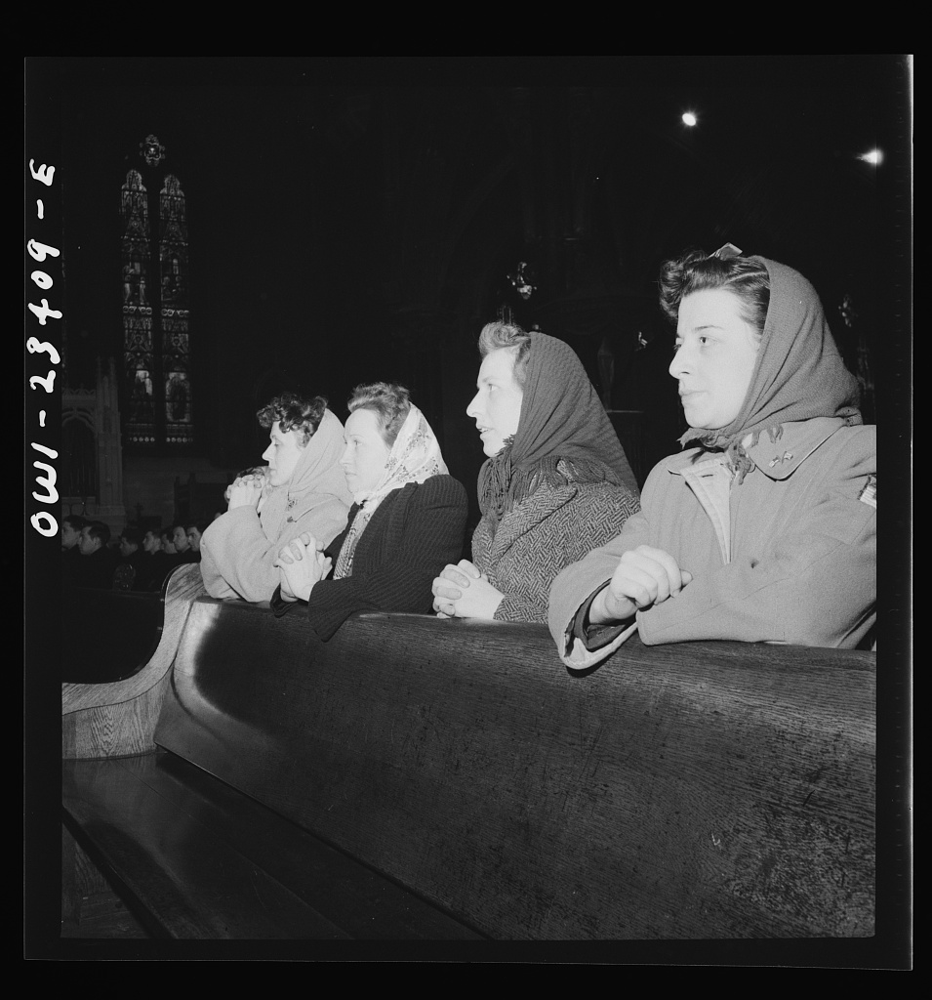
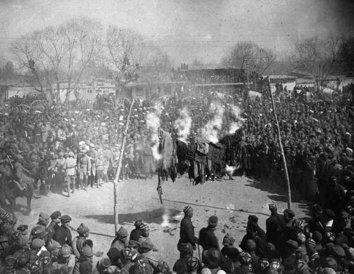
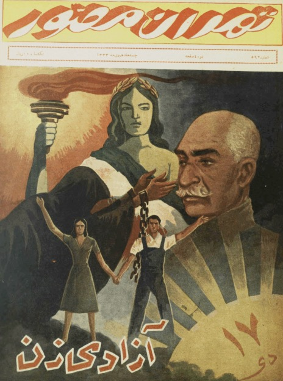
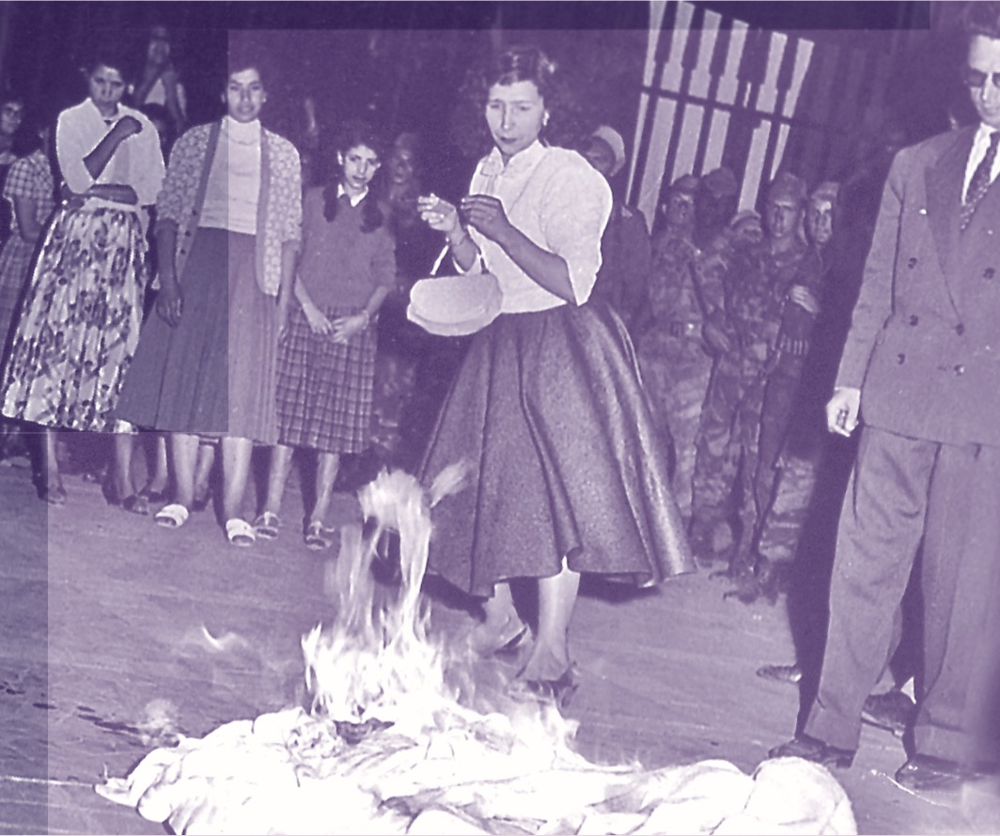
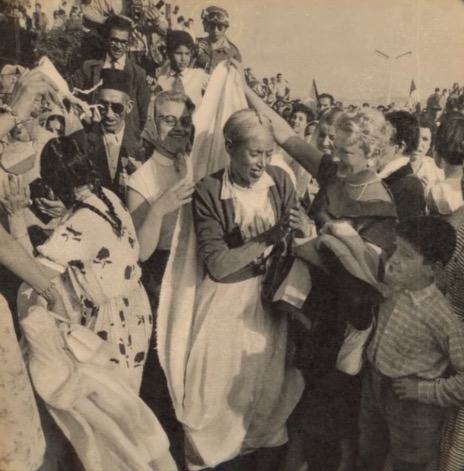

*The ninth in a series of essays on the veiling of women, following St. Paul's argument in 1 Corinthians 11. Having gathered the case for the veil at prayer and at all times, this essay turns to its history, and how it came to be lost.*

We closed the last essay with a question, namely how it came to be that so few women now give with their lives the answer which St. Paul and the Fathers gave, that the woman is to be covered at all times, and especially at prayer. Through the centuries, the practice of veiling in public settings has gone through many fluctuations. There have been periods of almost total veiling, and periods of less veiling. New, however, is the near eradication of veiling as seen since the early 1900s in the West. The aim of this essay is to demonstrate the cause of this novel phenomenon, and to establish that it was a result of modern philosophy, and not of the vicissitudes of culture normative in the human social experience.

There is an image which has gone around the world in recent years, in solidarity with the women of Iran, which shows a woman from behind, her shoulders bare and her hair drawn up and knotted on the top of her head in the shape of a raised fist, over the words "Woman, Life, Freedom." The cause that poster was made for is the overthrow of a compulsory veil in a Muslim state, and that is not our concern here. But the image itself says more than its makers perhaps intended. The very thing which St. Paul calls the glory of the woman, and which he bids her cover, is lifted up as a fist, the sign of rebellion, and nothing could be more directly contrary to the veil, which is the sign of a woman's willing place in the order of God. Thus the bare head of our age has become, as it were, a fist of hair.

*"Woman, Life, Freedom": a poster in solidarity with the women of Iran.*

It is not our intention to wander off into dark speculation. Yet we must not shrink from saying what is plain to see, that our modern culture is anti-Christian in very many ways, and to such a degree that even a Vicar of Christ has wondered aloud whether these were the last days. St. Pius X, at the very beginning of his pontificate, wrote that "there is good reason to fear lest this great perversity may be as it were a foretaste, and perhaps the beginning of those evils which are reserved for the last days; and that there may be already in the world the 'Son of Perdition' of whom the Apostle speaks" (Pius X, E Supremi 5). The loss of the veil belongs, then, to one of the periods of desolation in the long struggle of the Church Militant, and it is with that in mind that we turn to its history.

## The Long Norm

Up until the recent day, anywhere the Church was, in Greco-Roman culture, German, Slavic, African, and so on, the custom was to veil. Already at the end of the second century Tertullian could appeal to the practice of the churches across the known world, and that not even for married women, whose veiling he took for granted, but for virgins:

> Throughout Greece, and certain of its barbaric provinces, the majority of Churches keep their virgins covered. There are places, too, beneath this (African) sky, where this practice obtains; lest any ascribe the custom to Greek or barbarian Gentilehood.
> (Tertullian, On the Veiling of Virgins 2)

Nor was the covering of the matron a Christian invention. A Lapide notes that "out of modesty and dignified reserve head-coverings were worn in the time before Christ by the women of Judaea, Troy, Rome, Arabia, and Sparta" (Lapide, on 1 Cor 11:10, trans. Cobb). We need not dwell on the heathen. It suffices that nature, which teaches as St. Paul says, taught even those who had not the Gospel, and that Christians received this teaching of nature and raised it into a sign of the order of creation and redemption.

From St. Paul through the Fathers and into the law of the Church, which we traced in the previous essay, there runs a through line, namely that this is a matter which every age of the Church has had to address, and every age addressed it in similar fashion. The veil was disputed in its extent, in its age of beginning, in its fashion, and sometimes in its enforcement, but not in its principle. It is worth noting that when the Protestants broke with Rome, they did not regard the veil as a Romish peculiarity to be discarded with the rest, but read St. Paul in line with the Fathers. John Calvin, no friend of Catholic custom, writes:

> Here we have the second proposition, that women ought to have their heads covered when they pray or prophesy; otherwise they dishonor their head. For as the man honors his head by showing his liberty, so the woman, by showing her subjection. Hence, on the other hand, if the woman uncovers her head, she shakes off subjection, involving contempt of her husband.
> (Calvin, Commentary on 1 Corinthians 11:5, trans. Pringle)

John Wesley asks whether it is decent for a woman to pray to God when, "contrary to universal custom, she appears in public with her head uncovered" (Wesley, Explanatory Notes, 1 Cor 11:13), and Matthew Henry writes simply, "It was the common usage of the churches, for women to appear in public assemblies, and join in public worship, veiled; and it was right that they should do so" (Henry, Concise Commentary, 1 Cor 11:2-16). A modern summary observes that "Protestants generally followed St Paul's instructions on head coverings into the 20th century" (FIUV, Positio 22, sec. 11). Thus, whatever else divided Christians, they were not divided over the covered head of the Christian woman.

*"Upper-class women on the way to church with their maidservants," Reformed Basel, 1634. Hans Heinrich Glaser,* Basler Kleidung aller hoh- und nidriger Standts-Personen *(Basel, 1634), no. 33 (Universitätsbibliothek Basel).*

And the covered head was not only a thing of the church. Christian women were covered as a matter of course, in church and in the street, into living memory. A writer recalling the hats of the last century puts it thus: "at that time, in the 1920s and 30s and up through the first half of the 20th century, Western women of the middle and upper classes were expected to keep the tops of their heads hidden" (Holmes, "When Going Out Without a Hat Was Grounds for Scandal," Atlas Obscura). The hat was, in a sense, the last form of the veil in the street, and even it was expected until very recently.

*The* tapadas *of Lima, Peru, in the* saya y manto*, covered in the street but for one eye: nineteenth-century depictions.*

## When the Veil Begins

Before we follow the loss of the veil, we must answer a question which we set aside in the previous essay, namely when the veil begins, and how it pertains to maidens and to virgins. Here two customs have stood side by side through the history of the Church. Tertullian holds that the same law binds every woman from the time she comes to maturity:

> Again, while he says that 'nature herself,' which has assigned hair as a tegument and ornament to women, 'teaches that veiling is the duty of females,' has not the same tegument and the same honour of the head been assigned also to virgins? If 'it is shameful' for a woman to be shorn it is similarly so to a virgin too. From them, then, to whom is assigned one and the same law of the head, one and the same discipline of the head is exacted
> (Tertullian, On Prayer 22)

And he sets the beginning of that discipline at the passing of childhood, grounding it, as we have done throughout, in Eden:

> Under our dispensation, let that age which is ignorant of its sex retain the privilege of simplicity. For both Eve and Adam, when it befell them to be 'wise,' forthwith veiled what they had learnt to know. At all events, with regard to those in whom girlhood has changed (into maturity), their age ought to remember its duties as to nature, so also, to discipline; for they are being transferred to the rank of 'women' both in their persons and in their functions.
> (Tertullian, On Prayer 22)

On the other hand, there is the custom by which the veil is the mark of the wife, so that, as St. Isidore observed, the very name of the wedding is taken from the veiling of the bride, and the unmarried woman is she who "does not yet veil her face" (Isidore, Etymologies IX.7.10-11). Both customs are true to St. Paul, differing only in when the veil is taken, while agreeing that the order it signifies holds. The veil belongs to virgins insofar as they are women, and the order of creation reaches every woman. But it belongs especially to wives, who now have their Adam, and in whom the sign of headship is fulfilled in a living head. Nor does virginity set it aside, for our Lady, the ever-virgin, is for the most part shown to us veiled in the long tradition of Christian depiction, and the virgins consecrated to Christ have always taken the veil as the sign of their espousals. Of these we will say more when we come to the objections.

As for when a girl should begin, the Church has left this to prudence to decide, and we can only offer what has been fruitful in our own experience. Around the time of First Communion, our daughters have begun to see themselves, so to speak, as little women rather than as children, and the veil has helped them to do so. It is a progressive growth, much like a novitiate progressing towards its life vows, which for most will be the marriage ceremony, when the veil of the bride is taken in its fullness. The girl who learns to veil as a child will not find it strange to veil at her wedding, nor to keep it as a wife. Furthermore, the maidens under our charge bear the sign of subjection to their father before their husband, whether that husband be Christ himself or another.

## The Street and the Altar Rail

The loss of the veil came in a time of great societal change and experimentation, a time of questioning who we are, what it all means, and how the modern world could be reconciled with the life of the Church in ages past. We need not enter into the details of that upheaval to see the order in which the veil was lost. It went first in the street, and then at the altar rail.

In the street, the change began by and large in the years after the Great War. For a growing number of Western women, "beginning in the 1920s and continuing up until the 1960s, a hat or head covering felt like a symbol of control and regulation, a symbol of the rules created by men governing the bodies of women" (Holmes, Atlas Obscura). In Spain a circle of artists came to be called "Las Sinsombreros," the women without hats, for refusing to cover their heads in public. In the same years women began in great numbers to wear trousers as ordinary dress, a trend which "began during the early 1900s, became more widespread during the 1920s and 1930s, and continued to grow" ("Trousers for Women," Fashion, Costume, and Culture). The factories of the war had already put "many women" in "trousers and overalls," and the fashion followed, Coco Chanel herself being known for "often dressing in her boyfriend's suits" (ibid.). The uncovering of the head and the masculinizing of the woman's dress came together, and they came from the same source.

*Women of the circle later called "Las Sinsombreros," the women without hats, in Spain.*

*"Women factory workers attending mass at nine a.m. Sunday directly after working the third shift," Buffalo, New York, April 1943: their heads still covered, their slacks already on. Photograph by Marjory Collins (Library of Congress).*

Within the churches the veil held on longer. The Church of England was the first large ecclesial body to set it aside. In 1942 the Archbishop of Canterbury "told Anglican churchwomen that they could ignore St. Paul's 1,900-year-old edict" and "stop wearing hats in church," on account of the clothing rationing of the war ("Religion: Hats Off," TIME, November 30, 1942). It is telling that the occasion was less a principled argument and more a concession to the ravages of war. In the Catholic Church the veil remained the law, as was shown in the previous essay, under the canon of 1917, which required women to be "capite cooperto et modeste vestitae," i.e., "with the head covered and modestly dressed," at the sacred rites. When in 1969 the press reported that the Vatican had ended the practice, the secretary of the Congregation for Divine Worship denied it outright: "The rule has not been changed," he said. "It is a matter of general discipline. It began as a custom in the time of St. Paul and was later incorporated into canon law" (UPI, The Atlanta Journal, June 21, 1969). Yet the denial did not stop what the report had set in motion, and within a few years the veil had all but disappeared from the parishes of the West. When the new Code of Canon Law was promulgated in 1983, it abrogated the old one without repeating the canon, and so the law followed, rather than led, the loss of the practice. What the Church's law now asks, and what it does not, we will consider in the next essay.

## The Bonfires

It would be easy to suppose that this is a story of the West alone, a matter of changing fashion among Christians who had grown tired of an old-fashioned way. But the loss of the veil is something which the whole modern world has had to grapple with, and in much of the world it came about by force. The historian of the Algerian case sums up the pattern in a single sentence: "Long before the orchestration of mass unveiling ceremonies by the French army in Algeria during May 1958 (examined in chapter 3) such spectacles had occurred in Egypt (1923), Uzbekistan (1927) Syria (1942) and Lebanon (1944)" (MacMaster, Burning the Veil, 7). These were the veils of Muslim women, and we do not mean to entirely equate them with the Christian veil, nor to defend everything in the customs they belonged to. Our point is the method and the spirit of those who tore them away.

In Soviet Central Asia the Communist Party launched its campaign on International Women's Day of 1927, and one of its "central aims was to achieve the mass unveiling of indigenous women by October, to coincide with the tenth anniversary of the revolution" (McShane, "Women at the Heart of the Revolution"). The veil was to be burned in honor of the Revolution, and after the Second World War the socialist state of Yugoslavia did the same through its women's front, which "banned the veil as part of a process of constituting a new identity for female citizens in a burgeoning socialist state" (Hadžiristić, "Unveiling Muslim Women in Socialist Yugoslavia," 185). In Iran, Reza Shah, "much impressed by Kemal during his state visit to Turkey in 1934, sought to impose western dress as just one component of a much vaster programme to create a strong state" (MacMaster, Burning the Veil, 7).

*A veil-burning ceremony in Uzbekistan on International Women's Day, 8 March 1927, during the Hujum.*

*Cover of the Tehran weekly* Tehran-e Mosavvar *for 17 Dey, the anniversary of Reza Shah's unveiling decree of 1936, under the words "Women's Freedom."*

A most theatrical case is that of French Algeria. On the evening of 17 May 1958, in the midst of the army's seizure of power in Algiers, "a group of young Algerian women removed and burned their haïks before the General Government" (MacMaster, Burning the Veil, 115). The army's own photographer called it a "symbolic auto-da-fé," and his pictures "show a group of apprehensive girls aged about fourteen to sixteen being encouraged by two older Algerian women dressed in a European style and an elegant European woman, probably the wife of General Salan" (MacMaster, Burning the Veil, 128). General Salan telegraphed Paris that "groups of Muslim women burned their veils of their own accord, saying, 'Today we are French!'" (MacMaster, Burning the Veil, 129). It was, in fact, staged by the army's propaganda office. Here we see plainly that what the West offered was its own uncovering rather than any order, imposed upon others as the badge of its forced civilizing - the black ships came for all. It would rather violate and overturn and cause chaos than bring about any real order. A frightened girl burning her veil before soldiers so that her conquerors might say "Today we are French" is a picture of what modernity has meant for the psyche of womankind.

*Algiers, May 1958: veils burned before soldiers during the army's "fraternisation" demonstrations.*

*Algiers, May 1958: European women unveil an Algerian woman before the crowd.*

Is all of this the overthrow of an outdated custom of misogyny, as its authors claimed? Or is it something more? When the same act is performed across so many peoples, by liberal colonists, by communist commissars, and by modernizing kings, with the same bonfires and the same speeches about liberation, we might rightly suspect that it springs from a common source.

## The Spirit Behind It

That source is modern, post Enlightenment philosophy in all its strands together. Liberalism, socialism, and feminism differ in much, yet they share a common root, namely the refusal of a given order, the conviction that the human person is not placed by God within a created order, but makes and remakes himself by his own will. The movement against the veil flowed from the growing force of Liberalism and came to an end in the United States with the triumph of feminism. We need not guess at the spirit of that triumph, for the National Organization for Women set it down in writing:

> RESOLUTION ON HEAD COVERINGS 1968 WHEREAS, the wearing of a head covering by women at religious services is a custom in many churches and whereas it is a symbol of subjection within these churches, NOW recommends that all chapters undertake an effort to have all women participate in a 'national unveiling' by sending their head coverings to the task force chairman immediately. At the Spring meeting of the Task force on Women in Religion, these veils will then publicly be burned to protest the second class status of women in all churches.
> (National Organization for Women, Policy Manual, "Resolution on Head Coverings," 1968)

The vitriol of that resolution speaks for itself. And it is worth noting that NOW read the veil exactly as Calvin had done, and many a Father before him. Calvin said that "if the woman uncovers her head, she shakes off subjection"; NOW said the veil is "a symbol of subjection" and must therefore be burned. Thus they agree on what the sign means, and differ only in whether the subjection is to be embraced or shaken off, and this is the spirit of rebellion, and it is directly contrary to the spirit of the veil, which is the spirit of the Handmaid. The socialists said the same in their own language, treating the veil as "a signifier of hierarchical class and gender relations" to be stripped away (Hadžiristić, 185), and the modernizing rulers in theirs, treating it as an obstacle to the strong and Westernized state they meant to build.

The fist of hair, then, is no accident of fashion, but the visible form of a refusal, the same refusal which the father of lies first made, raised on the very head which St. Paul bids the woman cover.

## What the Loss Reveals

St. Paul calls the woman's hair her glory, and the Scriptures do not hesitate to number it among her beauties. The beauty of a woman, and especially of her hair, is a real thing, given by God, and it is precisely because it is real that it is to be guarded. Indeed, the sensuality of woman, unguarded, has been used as a weapon both against herself and against the health of society as a whole. That our culture now says hair means nothing, and at the same time raises it as a banner of revolt, shows that it knows better than it says. We will answer the claim that hair is no longer a matter of sexual modesty among the objections in the next essay.

What the loss of the veil reveals most of all is the loss of the woman's likeness to our Lady. When the angel came to her, she answered: "Behold the handmaid of our Lord, be it done to me according to thy word" (Luke 1:38, Rheims 1582). That word is the inner form of which the veil is the outward sign. By donning the veil women make themselves icons of our Lady, thus they demonstrate her divine humility and subjugation. She, being the new Eve, and even more than Eve in the garden, had no need of the veil as a remedy, there being nothing in her to restrain. Yet she wore it, as she kept the law of purification, "to which, nevertheless, she was not subject...it was becoming that the mother should be like her Son in humility" (Aquinas, Summa Theologiae III q.37 a.4). Nor was the sign without its use in her, since she stood truly under the headship of Joseph, and lived among men who were not like her. She thus bore the sign whose remedy she did not need, as her Son, who had no need of baptism, was baptized, saying, "so it becometh us to fulfil all justice" (Matt 3:15, Rheims 1582), and by his descent blessed the waters. She was veiled in a subjugation of love of the Holy Ghost. The woman who takes off the veil in the spirit of the fist does not only uncover her head; she turns, whether she knows it or not, from the icon of handmaid to the icon of rebel, from the new Eve back to the old.

And the loss of this one sign has run together with the loss of the distinction of the sexes itself. The movement of dissolution of modesty and differentiation between the sexes is almost complete in our day, even now coming to the physical and biochemical characteristics of our sexes, so that the effect could be assumed to reach the point of an apex: an asexual world, or perhaps a hermaphroditic one. The state of our bodily and sexual identity, and of the identity of the masculine and the feminine, is in a downward spiral which our grandparents probably could scarcely have imagined. Is the loss of the veil a symptom of this, or a cause? It is both, a symptom, for the veil went away before things grew so bad, and it went because the spirit which has brought us here was already at work in us. But it is also a cause, for, as we saw in the previous essay, signs teach the interior, and a people which no longer wears the sign of the order of the sexes will in time forget that there is such an order.

## No Argument

If, then, the veil fell by force and by fashion, by bonfires and by the rationing of hats, it did not fall by argument of a new rationalization according to true enlightenment. Nowhere in this history are the reasons of St. Paul answered, but only abandoned. Yet there are arguments raised against the veil today, some of them to be taken seriously, and it would not be honest to pass them over because their history does them little credit. To these we turn in the next essay.

## Works Cited

- Aquinas, Thomas. *Summa Theologiae*. Trans. Fathers of the English Dominican Province (Benziger, 1947).
- Calvin, John. *Commentary on the First Epistle to the Corinthians*. Trans. John Pringle (Calvin Translation Society, 1848).
- *Codex Iuris Canonici* (1917).
- FIUV (Una Voce). *Headcoverings in Church in the Extraordinary Form*. Positio 22 (2014).
- Hadžiristić, Tea. "Unveiling Muslim Women in Socialist Yugoslavia: the Body between Socialism, Secularism, and Colonialism." *Religion and Gender* 7.2 (2017): 184-203.
- Henry, Matthew. *Concise Commentary on the Whole Bible*.
- Holmes, Tao Tao. "When Going Out Without a Hat Was Grounds for Scandal." *Atlas Obscura*, March 21, 2016.
- Isidore of Seville. *Etymologiae*. Ed. W. M. Lindsay.
- Lapide, Cornelius a. *The Great Commentary of Cornelius à Lapide: I Corinthians*. Trans. W. F. Cobb (John Grant, 1908).
- MacMaster, Neil. *Burning the Veil: The Algerian War and the 'Emancipation' of Muslim Women, 1954-62*. Manchester University Press, 2009.
- McShane, Anne. "Women at the Heart of the Revolution."
- National Organization for Women. *Policy Manual: Issues M-Z, 1966-1996*.
- *The New Testament of Iesus Christ*. Rheims, 1582.
- Pius X. *E Supremi* (1903).
- "Religion: Hats Off." *TIME*, November 30, 1942.
- Tertullian. *On Prayer*. Ante-Nicene Fathers, vol. 3.
- Tertullian. *On the Veiling of Virgins*. Ante-Nicene Fathers, vol. 4.
- "Trousers for Women." In *Fashion, Costume, and Culture*.
- UPI. "Women Required To Cover Head, Vatican Insists." *The Atlanta Journal*, June 21, 1969.
- Wesley, John. *Explanatory Notes upon the New Testament* (1755).
